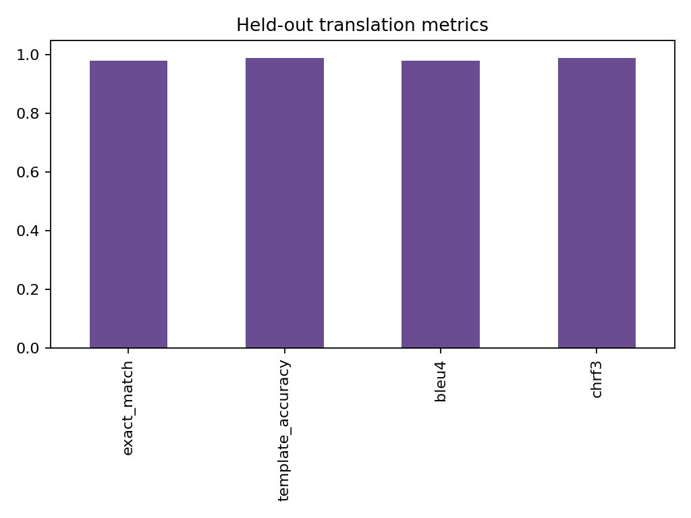

# English-to-French ML Translator

A fully offline hybrid translation system combining character n-gram TF-IDF,
a linear template classifier, constrained nearest-neighbour retrieval, BLEU-4,
character F-score evaluation, persistence, tests, and a JSON API.

The included 10,000-pair corpus is synthetic and deterministic. It was built
for reproducible learning and deployment without downloading copyrighted or
unversioned training data. It should not be described as a production-quality
general-purpose neural translator.

## Quickstart

```bash
python -m venv .venv
source .venv/bin/activate
python -m pip install -r requirements-dev.txt
python data/build_dataset.py
jupyter notebook English_French_Translator_Complete.ipynb
python app.py --model artifacts/translator.joblib
```

```bash
curl -X POST http://localhost:8002/translate \
  -H 'Content-Type: application/json' \
  -d '{"text":"i like the book"}'
```

## Reproduce and verify

Use Python 3.11 or 3.12 and run commands from this repository root.

```bash
python -m pip install -r requirements-dev.txt
python -m pytest -q tests
```

Run the canonical notebook top to bottom to regenerate the saved model and metrics. Saved `.joblib` models should be loaded with the scikit-learn version recorded in `VALIDATION.md`, or rebuilt with the notebook after changing versions.

The HTTP entrypoint is a local demonstration service. Use `docker build -t english-french-translator .` to build its container; the Docker build itself is not certified by local Python tests.

## Results and data

Saved measurements are in `artifacts/metrics.json`. See [data provenance and scope](DATA_PROVENANCE.md).


